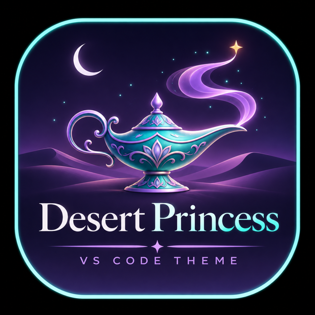
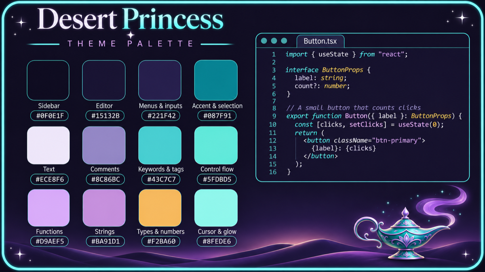

<p align="center"></p>

# Desert Princess

A dark VS Code theme with desert-night indigo, palace turquoise, lilac silk and a glint of lamp gold.

## Palette

<p align="center"></p>

| Role | Color |
| --- | --- |
| Sidebar and panels | `#0F0E1F` |
| Editor background | `#15132B` |
| Menus, inputs and widgets | `#221F42` |
| UI accent (selection, buttons) | `#087F91` |
| Text | `#ECE8F6` |
| Comments | `#8C86BC` |
| Keywords, operators, tags | `#43C7C7` |
| Control flow (import, return, if) | `#5FDBD5` |
| Functions and methods | `#D9AEF5` |
| Keys and attributes | `#D8C6EC` |
| Strings | `#BA91D1` |
| Types, numbers, constants | `#F2BA60` |
| Cursor, highlights and glow | `#8FEDE6` |

## Install

Search for **Desert Princess** in the Extensions view, or run:

```
code --install-extension thaisemanuele.desert-princess
```
